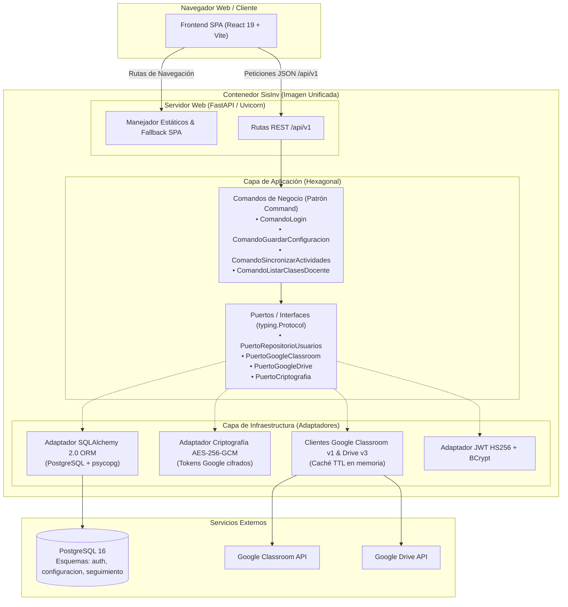

# SisInv — Sistema de Investigación

[](LICENSE)
[](https://www.python.org/)
[](https://fastapi.tiangolo.com)
[](https://react.dev/)
[](https://www.sqlalchemy.org/)
[](#pruebas-y-calidad)

**SisInv (Sistema de Investigación)** es una plataforma de código abierto de grado institucional diseñada para la gestión, seguimiento y supervisión de actividades de investigación formativa y académica, con sincronización e integración nativa a **Google Classroom** y **Google Drive**.

Inspirada en el modelo de distribución y arquitectura de **Apache Superset**, SisInv empaqueta su Frontend (React 19 SPA) y Backend (Python FastAPI) en una **imagen única unificada de Docker**, ofreciendo máxima facilidad de despliegue, seguridad criptográfica y una potente herramienta de línea de comandos (`sisinv` CLI).

---

## 🏛️ Arquitectura del Sistema

El backend está construido bajo los principios de **Arquitectura Hexagonal (Ports & Adapters)** y **SOLID**, manteniendo el dominio de negocio totalmente desacoplado de los detalles tecnológicos y librerías externas. Además, todo el código, variables, entidades y comandos están rigurosamente desarrollados en **idioma español**.



---

## ✨ Características Principales

- **Distribución All-in-One (Estilo Apache Superset)**: Un solo contenedor sirve tanto los archivos estáticos optimizados de la SPA como los endpoints REST de FastAPI bajo el mismo origen.
- **Arquitectura Hexagonal & SOLID**: Separación nítida entre Dominio, Aplicación (Comandos) e Infraestructura (Adaptadores).
- **ORM Avanzado SQLAlchemy 2.0 & Migraciones Alembic**: Mapeo declarativo moderno con anotaciones `Mapped[...]`, soporte multi-esquema nativo (`auth`, `configuracion`, `seguimiento`) y migraciones automáticas.
- **Criptografía de Grado Militar (AES-256-GCM)**: Cifrado autenticado de credenciales y tokens OAuth2 de Google, 100% interoperable a nivel binario con sistemas legados Java/Spring (`12-byte IV + ciphertext + 16-byte GCM tag`).
- **Autenticación Híbrida Segura**: Soporte para cookies `HttpOnly; SameSite=Lax` y cabeceras estándar `Authorization: Bearer <token>`. Hashing de contraseñas con **BCrypt** compatible con Spring Security.
- **Herramienta CLI SisInv**: Administración centralizada desde la terminal (`sisinv run`, `sisinv init`, `sisinv db upgrade`, `sisinv create-admin`).
- **Frontend de Alto Rendimiento**: React 19, TypeScript, Vite, Tailwind CSS, Lucide Icons y Zustand.

---

## 📁 Estructura del Monorepo

```
gccinv/
├── Dockerfile                   # Construcción multi-stage de la imagen unificada
├── docker-compose.yml           # Despliegue con PostgreSQL y SisInv
├── docker-compose.dev.yml       # Entorno local para base de datos aislada
├── .env.example                 # Variables de entorno documentadas
├── sql/                         # Scripts DDL para esquemas PostgreSQL
│   ├── 00_esquemas.sql
│   ├── 01_estructura.sql
│   ├── 02_agregar_carpeta_drive.sql
│   ├── 03_agregar_estados_configuracion.sql
│   └── 04_crear_actividades_seguimiento.sql
├── backend/                     # Backend Python (FastAPI + SQLAlchemy 2.0)
│   ├── alembic/                 # Control de versiones de base de datos
│   ├── alembic.ini              # Configuración de Alembic
│   ├── pyproject.toml           # Manifiesto y punto de entrada CLI (sisinv)
│   ├── requirements.txt         # Dependencias de producción
│   ├── tests/                   # Pruebas automatizadas (Pytest)
│   └── sisinv/                  # Paquete principal en español
│       ├── dominio/             # Entidades y excepciones puras
│       ├── aplicacion/          # Casos de uso (Comandos) y Puertos
│       ├── infraestructura/     # ORM, Seguridad, Google APIs y API REST
│       ├── fabrica_aplicacion.py# Fábrica FastAPI create_app()
│       └── cli.py               # Línea de comandos Click
└── frontend/                    # Frontend React 19 + TypeScript + Vite
    ├── src/                     # Código fuente modular
    ├── vite.config.ts           # Configuración del bundler
    └── package.json             # Dependencias del cliente
```

---

## 🚀 Inicio Rápido con Docker

La forma más rápida de ejecutar SisInv es mediante **Docker Compose**:

### 1. Clonar el repositorio y configurar variables
```bash
git clone https://github.com/iamrodrigodev/sisinv.git
cd sisinv
cp .env.example .env
```

### 2. Iniciar los servicios
```bash
docker compose up -d --build
```

### 3. Crear el usuario Administrador inicial
Al igual que en Apache Superset, puedes invocar la CLI dentro del contenedor:
```bash
docker compose exec sisinv sisinv create-admin
```
El asistente te solicitará el correo electrónico y la contraseña del administrador.

### 4. Acceder al sistema
Abre tu navegador en:
👉 **http://localhost:8080**

---

## 🛠️ Herramienta de Línea de Comandos (`sisinv` CLI)

El comando `sisinv` proporciona utilidades directas para la administración del sistema:

| Comando | Descripción |
| :--- | :--- |
| `sisinv run` | Inicia el servidor web Uvicorn (opciones `--host`, `--port`, `--workers`, `--reload`). |
| `sisinv init` | Inicializa los esquemas PostgreSQL (`auth`, `configuracion`, `seguimiento`) y aplica migraciones. |
| `sisinv db upgrade` | Ejecuta las migraciones pendientes de Alembic hasta la última versión (`head`). |
| `sisinv db migrate -m "descripción"` | Autogenera una nueva migración de base de datos comparando modelos ORM. |
| `sisinv create-admin` | Crea interactivamente un nuevo usuario con rol de Administrador. |

---

## 💻 Desarrollo Local

Si prefieres desarrollar localmente sin Docker para los servicios de aplicación:

### Requisitos
- **Python 3.12+**
- **Node.js 22+**
- **PostgreSQL 16+**

### Paso 1: Levantar la base de datos
```bash
docker compose -f docker-compose.dev.yml up -d
```

### Paso 2: Configurar y ejecutar el Backend
```bash
cd backend
python3 -m venv .venv
source .venv/bin/activate
pip install -r requirements.txt
pip install -e .

# Inicializar base de datos y crear admin
sisinv init
sisinv create-admin --email admin@institucion.edu.pe

# Ejecutar con recarga en caliente
sisinv run --reload --port 8080
```

### Paso 3: Configurar y ejecutar el Frontend
En otra terminal:
```bash
cd frontend
npm ci
npm run dev
```
El servidor de desarrollo de Vite estará disponible en `http://localhost:5173`, redirigiendo automáticamente las llamadas de API a `http://localhost:8080/api/v1`.

---

## 🧪 Pruebas y Calidad

El proyecto cuenta con una cobertura integral de pruebas automatizadas:

### Pruebas del Backend (Pytest)
```bash
cd backend
.venv/bin/python -m pytest -v
```
- ✅ **17 pruebas unitarias y de integración** cubriendo criptografía AES-GCM, seguridad JWT/BCrypt, limitadores de tasa, comandos de aplicación y endpoints REST FastAPI.

### Pruebas del Frontend (Vitest)
```bash
cd frontend
npm test
```
- ✅ **498 pruebas unitarias y de interfaz** cubriendo stores Zustand, componentes React, validaciones Zod y flujos de autenticación.

---

## 🔒 Variables de Entorno

| Variable | Descripción | Valor por Defecto |
| :--- | :--- | :--- |
| `PORT` | Puerto HTTP donde escuchará el servidor. | `8080` |
| `HOST` | Interfaz de red para el servidor. | `0.0.0.0` |
| `DB_HOST` | Host del servidor PostgreSQL. | `localhost` (o `db` en docker) |
| `DB_PORT` | Puerto de conexión a PostgreSQL. | `5432` |
| `DB_NAME` | Nombre de la base de datos. | `sistema_investigacion` |
| `DB_USER` | Usuario de base de datos. | `investigacion` |
| `DB_PASSWORD` | Contraseña de base de datos. | `postgres` |
| `APP_JWT_SECRET` | Clave secreta para la firma y verificación de JWT (HS256). | *(generar en prod)* |
| `APP_MASTER_KEY` | Clave maestra AES-256 para el cifrado de tokens Google. | *(32+ caracteres)* |
| `COOKIE_SECURE` | Define el flag `Secure` en cookies de sesión (activar en HTTPS). | `false` |
| `APP_CORS_ORIGINS` | Lista de orígenes permitidos separados por comas. | `http://localhost:8080` |

---

## 📄 Licencia

Este proyecto está licenciado bajo los términos de la **Apache License 2.0**. Consulta el archivo [LICENSE](LICENSE) para más detalles.
